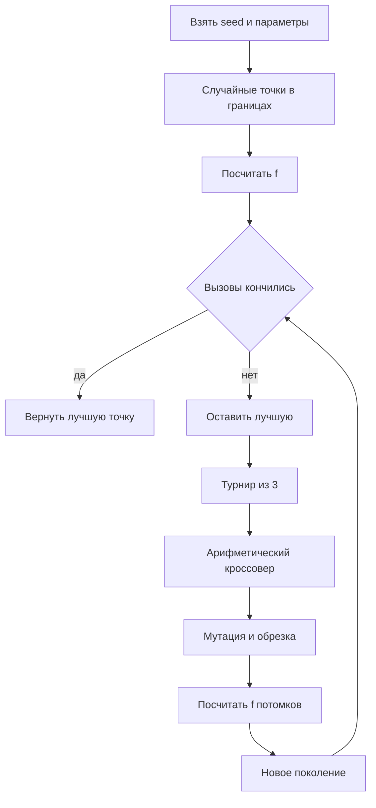
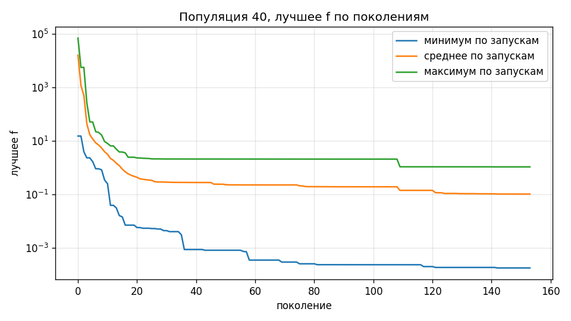
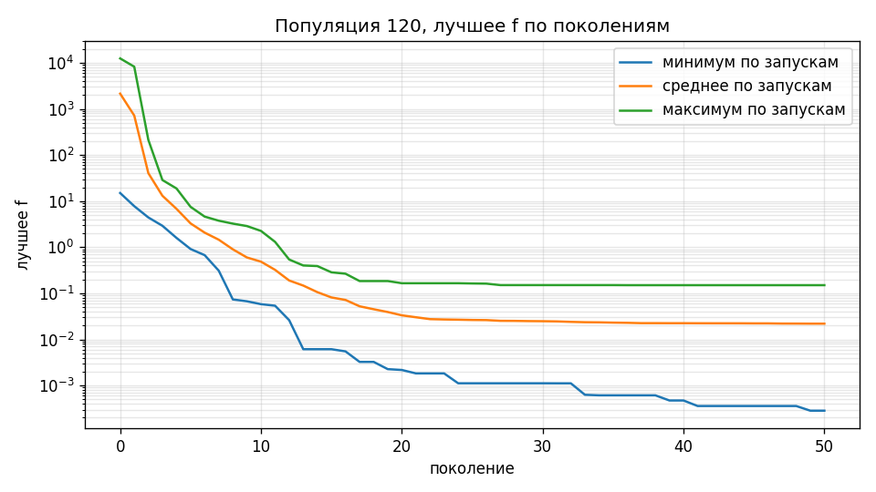
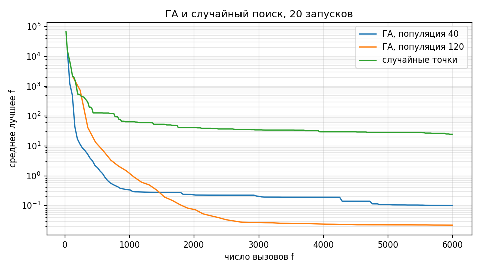

# Лабораторная работа 1

Многомерная оптимизация функции Discus генетическим алгоритмом.

## Постановка и вариант

Нужно приближённо найти минимум функции на ограниченной области. Мои параметры: N = 3, Q = 0, Y = 26.

V = 1 + ((17·3 + 26) mod 20) = 1 + (77 mod 20) = 18.

Размерность d = 5 + (18 mod 6) = 5.

Ищу минимум f(x), x = (x1, x2, x3, x4, x5).

## Функция, область, особь

Функция Discus:

f(x) = 10^6 · x1^2 + x2^2 + x3^2 + x4^2 + x5^2.

Каждая координата лежит в отрезке [-5, 5]. Других ограничений нет. Минимум известен: в точке (0, 0, 0, 0, 0) значение равно 0. В углах области значение доходит примерно до 2,5·10^7.

Особь — это сами пять чисел. Отдельно кодировать их не нужно, генотип и фенотип совпадают.

Первая координата входит с множителем 10^6. Чтобы её вклад был около 1, |x1| должен быть около 0,001. На отрезке длины 10 это узкая полоса. Случайная точка почти никогда туда не попадает. Если поиск шагает по всем координатам одинаково крупно, он легко проскакивает эту полосу. Если шаг сделать маленьким, по остальным четырём координатам он будет ползти очень долго. Поэтому ни случайные точки, ни простой локальный поиск с одним шагом на все оси эту функцию быстро не берут.

## Алгоритм и параметры

Оба опыта ГА отличаются только размером популяции. Остальное общее.

| параметр | значение |
| --- | --- |
| популяция | 40 и отдельно 120 |
| бюджет | 6000 вызовов f, включая стартовую популяцию |
| отбор родителей | турнир из 3 |
| кроссовер | арифметический, вероятность 0,9 |
| мутация | по каждой координате с вероятностью 0,2 |
| шаг мутации | нормальный шум, σ = 0,1 · (5 − (−5)) = 1 |
| границы | если координата вышла за ±5, ставлю ±5 |
| элитизм | лучшая особь переходит в следующее поколение как есть |
| старт | каждая координата равномерно из [-5, 5] |
| останов | кончились 6000 вызовов |
| seed | 1, 2, …, 20, записаны в JSON |

При популяции 40 получается 153 поколения, при 120 — 50. Бюджет один и тот же, поэтому большая популяция живёт меньше поколений.

Кроссовер: a — случайное число от 0 до 1, ребёнок = a · родитель1 + (1 − a) · родитель2. Второй ребёнок считается с весом (1 − a). Если кроссовер не сработал, дети просто копии родителей, и дальше всё равно идёт мутация.

Турнир взял потому, что значения f отличаются на порядки. Для рулетки пришлось бы отдельно пересчитывать шкалу. В турнире это не нужно: сравниваются три числа, берётся меньшее.

Арифметический кроссовер здесь уместен по простой причине. Если у обоих родителей x1 уже маленькая, у ребёнка она тоже останется между ними, а не прыгнет в случайное место отрезка.

Файлы параметров: `config_base.json` и `config_pop120.json`.

## Блок-схема

## Результаты

Было 20 независимых запусков на каждую настройку и ещё 20 запусков случайного поиска. У случайного поиска те же границы, те же seed и те же 6000 вызовов f. В таблицу вошли все запуски, не один удачный.

Все полученные точки лежат внутри границ: после мутации координата обрезается. Недопустимых решений не было.

| настройка | лучшее | среднее | медиана | ст. откл. | худшее | среднее время, с | вызовов |
| --- | ---: | ---: | ---: | ---: | ---: | ---: | ---: |
| популяция 40 | 1,73·10⁻⁴ | 0,101 | 0,0127 | 0,247 | 1,05 | 0,077 | 6000 |
| популяция 120 | 2,84·10⁻⁴ | 0,0220 | 0,00283 | 0,0440 | 0,150 | 0,074 | 6000 |
| случайные точки | 6,86 | 24,2 | 22,4 | 10,1 | 46,3 | 0,046 | 6000 |

Лучшая точка при популяции 40 (seed 11):

x ≈ (1,26·10⁻⁵, 7,49·10⁻⁴, 3,20·10⁻⁴, −6,70·10⁻⁴, −3,55·10⁻³), f ≈ 1,73·10⁻⁴.

По вертикали на графиках логарифм. Иначе падение в первых поколениях закрывает всё остальное.

## Что из этого видно

Случайный поиск за 6000 точек в среднем остаётся около 24. Даже его лучший запуск, f = 6,86, это точка, где x1 уже случайно попала около −0,00053, а остальные координаты всё ещё порядка единицы. То есть поймать узкую полосу по x1 иногда удаётся, а подобрать сразу все пять чисел — нет.

Генетический алгоритм уходит гораздо ниже. При популяции 40 лучший запуск около 1,7·10⁻⁴, медиана около 0,013. Среднее 0,101 тянет вверх один слабый запуск с f = 1,05. После примерно 40-го поколения кривые почти ложатся: шаг мутации равен 1, а для дальнейшего уменьшения f нужны уже очень маленькие поправки к x1.

Смена только размера популяции с 40 на 120 при том же бюджете даёт другой эффект, чем «просто больше особей — лучше рекорд». Поколений меньше, 50 вместо 153, и самый лучший запуск даже чуть хуже: 2,8·10⁻⁴ против 1,7·10⁻⁴. Зато типичный запуск лучше. Среднее падает с 0,101 до 0,022, медиана с 0,0127 до 0,00283, худший результат с 1,05 до 0,150, разброс тоже меньше. На графике сравнения кривая популяции 120 после примерно 1500 вызовов идёт ниже кривой популяции 40. Большая популяция здесь уменьшает число слабых запусков, а не дожимает рекорд.

## Вывод по качеству

Для этой задачи результат приемлемый. Известный минимум равен 0, и лучшие точки к нему близки, если помнить масштаб: на области функция доходит до миллионов. Отрыв от случайного поиска большой и повторяется на серии, а не в одном seed. Точным ответом это не является. До нуля алгоритм не доходит, при популяции 40 один запуск из двадцати остался около 1, и после двух тысяч вызовов улучшения почти нет. Чтобы дожимать x1 дальше, нужен меньший шаг мутации ближе к концу, но это уже другой опыт: в этой работе шаг не менялся.
